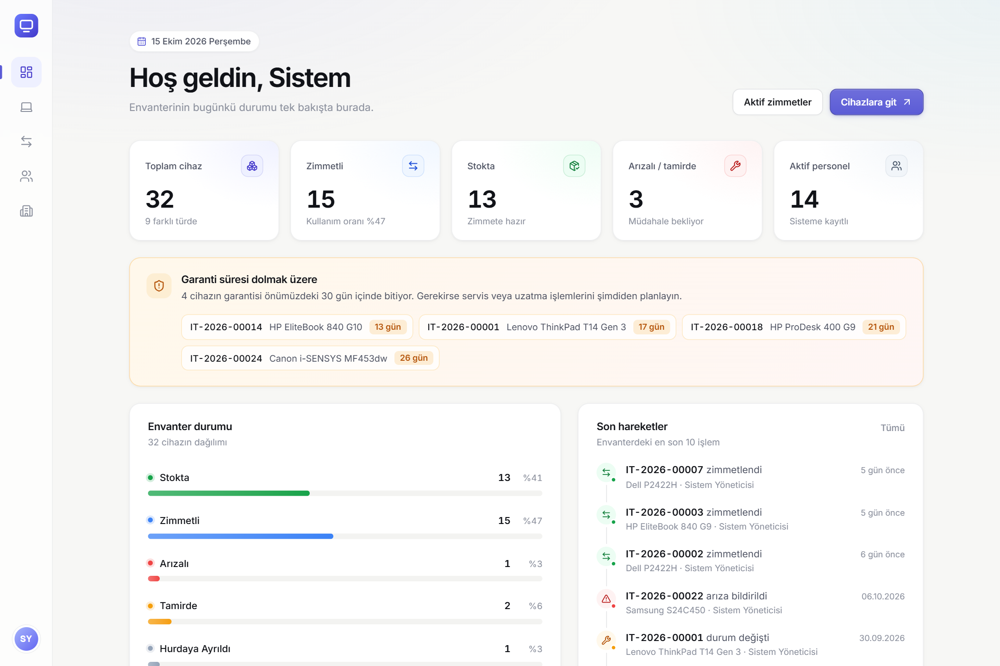
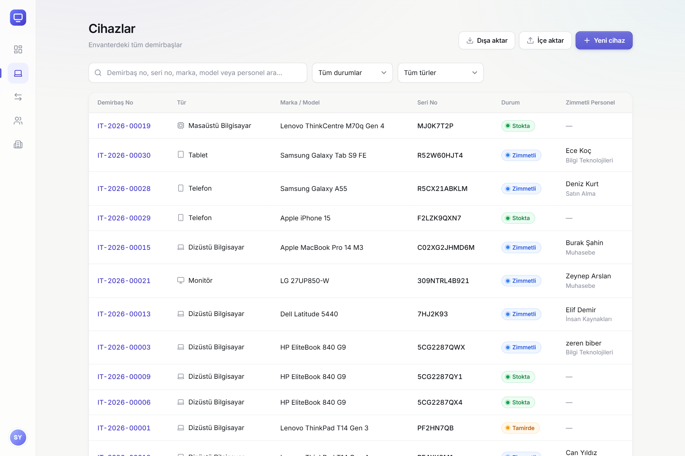
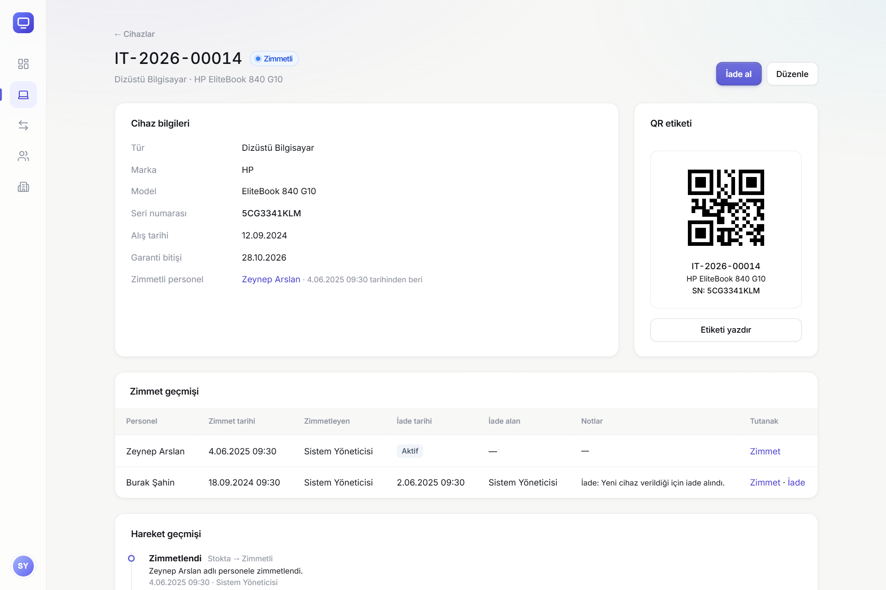
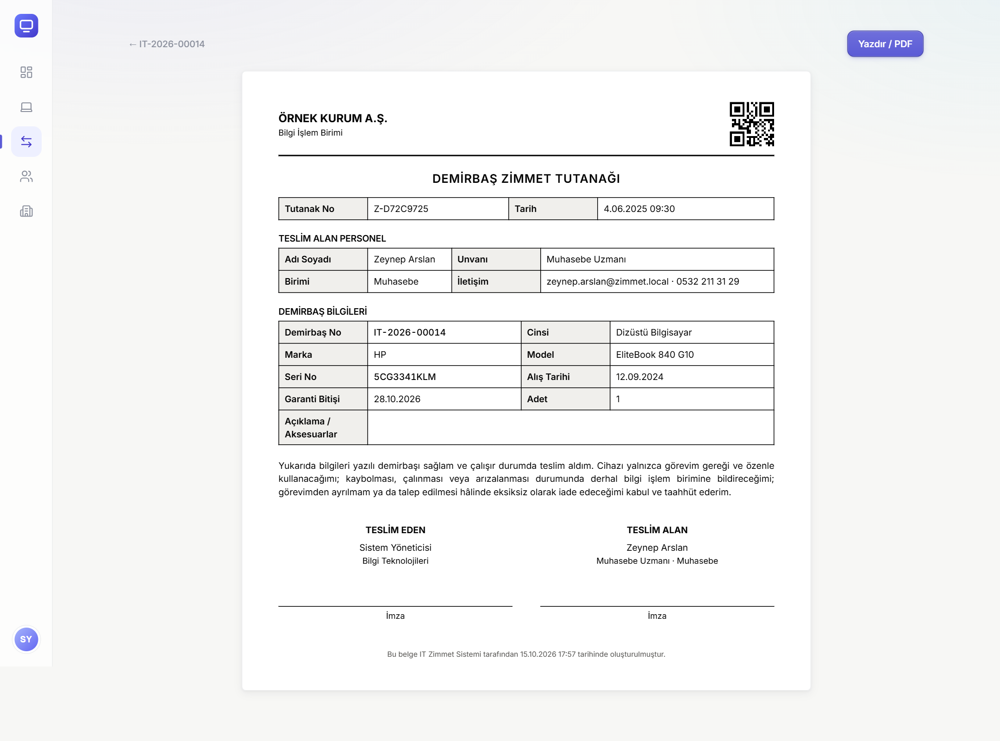
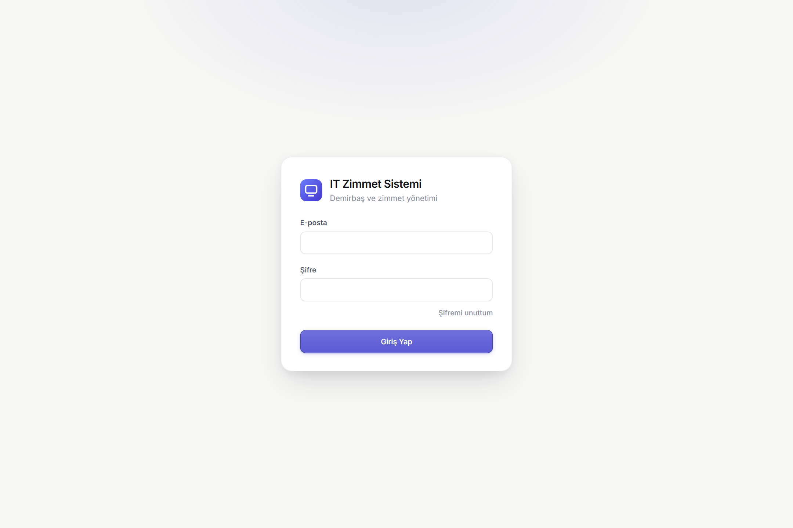
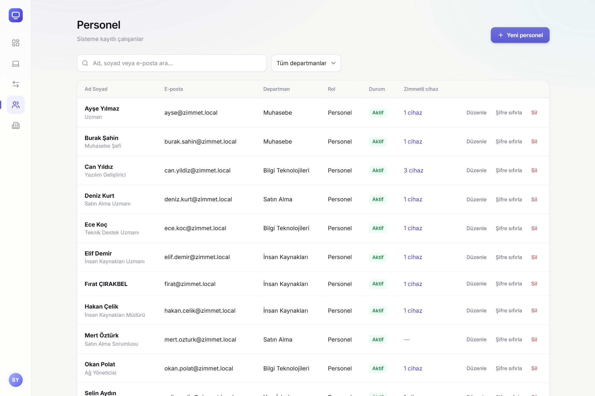
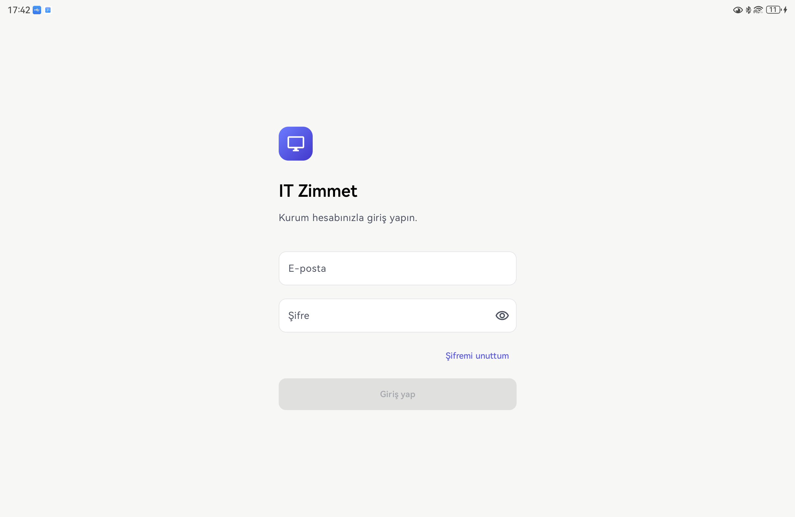
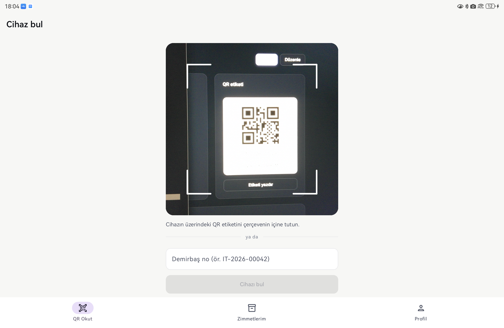
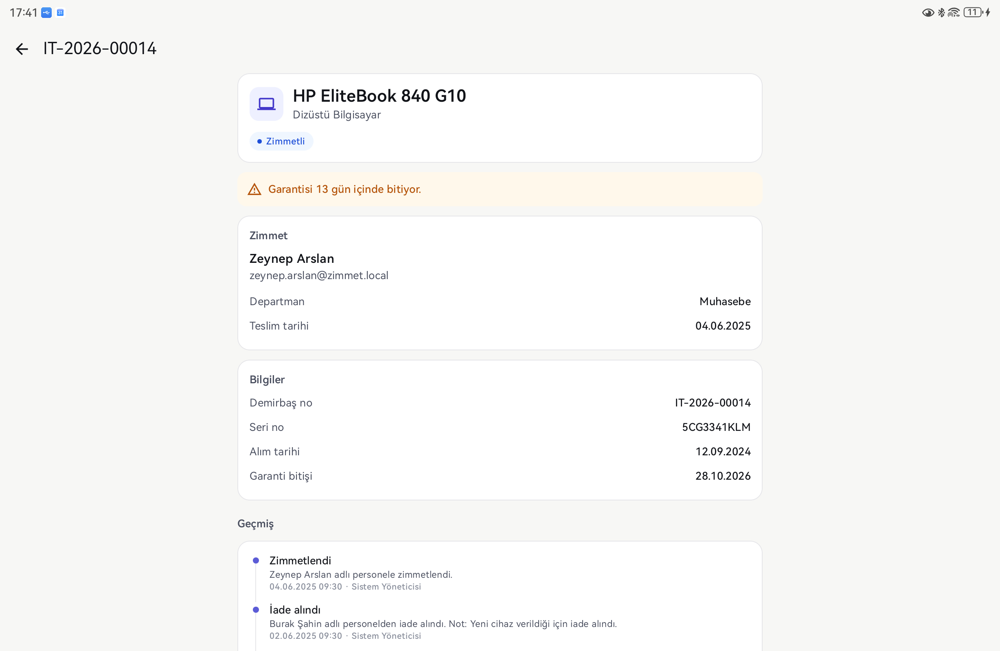
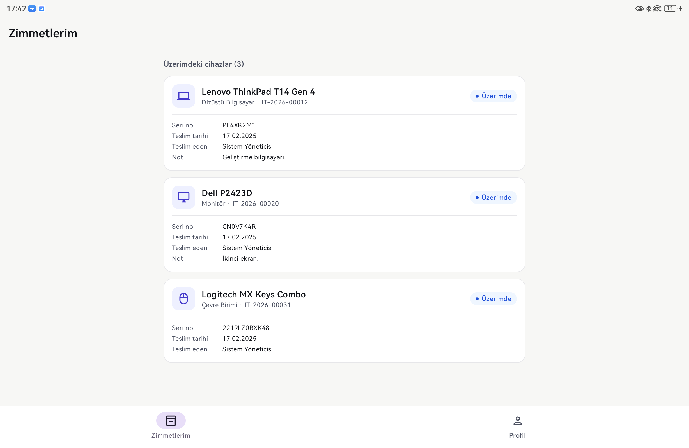

# IT Zimmet Sistemi

Bir kurumdaki bilgisayar, monitör, yazıcı, telefon gibi cihazların kimde olduğunu takip etmek için
yaptığım bir proje. Genelde bu iş Excel dosyalarıyla ya da kâğıt tutanaklarla yürüyor, cihaz kimde,
ne zaman verildi, garantisi ne zaman bitiyor gibi bilgiler kayboluyor. Bu sistemde hepsi tek yerde duruyor.

Proje üç parçadan oluşuyor:

- **API**: Node.js + Express + PostgreSQL
- **Web paneli**: React, yöneticinin kullandığı arayüz
- **Android uygulaması**: Kotlin + Jetpack Compose, cihazın QR etiketini okutup bilgilerine bakmak için

## Ekran görüntüleri

### Web

| Gösterge paneli | Cihazlar |
| --- | --- |
|  |  |

| Cihaz detayı | Zimmet tutanağı |
| --- | --- |
|  |  |

| Giriş | Personel |
| --- | --- |
|  |  |

### Mobil

| Giriş | QR okutma |
| --- | --- |
|  |  |

| Cihaz detayı | Zimmetlerim |
| --- | --- |
|  |  |

## Neler yapılabiliyor

- Cihaz ekleme, düzenleme, silme. Her cihaza otomatik demirbaş numarası veriliyor (`IT-2026-00042` gibi)
  ve bu numarayla bir QR etiket oluşuyor.
- Cihazı personele zimmetleme, iade alma ve bunların yazdırılabilir tutanağı.
- Cihaz durumu: stokta, zimmetli, arızalı, tamirde, hurda. Her değişiklik cihazın geçmişine yazılıyor.
- Excel'den toplu cihaz ekleme ve listeyi Excel'e aktarma.
- Gösterge panelinde cihaz sayıları, garantisi 30 gün içinde bitecek cihazlar ve son işlemler.
- Personel ekleyince şifre sistem tarafından üretilip e-postayla gidiyor, ilk girişte değiştirmek zorunlu.
- Şifremi unuttum: e-postaya 6 haneli kod geliyor, kodla yeni şifre belirleniyor.
- İki rol var. Yönetici her şeyi yönetiyor, personel sadece kendi üzerindeki cihazları görüyor.
- Mobil uygulamada yönetici QR okutarak cihazı buluyor, personel kendi zimmetlerini görüyor.

## Kullandıklarım

- **Backend:** Node.js, Express 5, TypeScript, Prisma, PostgreSQL, Zod, JWT
- **Web:** React 19, Vite, React Router, TanStack Query
- **Mobil:** Kotlin, Jetpack Compose, Retrofit, DataStore, CameraX, ML Kit
- **Diğer:** Docker Compose (veritabanı ve test için mail sunucusu), ExcelJS, Nodemailer

## Klasör yapısı

```
apps/
├── api/          Backend
│   ├── prisma/   Veritabanı şeması, migration'lar, başlangıç verisi
│   └── src/
│       ├── modules/      auth, devices, assignments, users, departments, dashboard
│       ├── middlewares/  giriş kontrolü, veri doğrulama, hata yakalama
│       └── lib/          şifre, e-posta, arama gibi ortak kodlar
├── web/          Yönetim paneli
│   └── src/      pages, components, api, auth
└── mobile/       Android uygulaması
    └── app/src/main/java/com/itzimmet/mobile/
        ├── data/ API çağrıları ve token saklama
        └── ui/   ekranlar ve ViewModel'ler
```

Backend'de her modülde üç dosya var: `routes` (uç noktalar), `schemas` (gelen verinin kontrolü) ve
`service` (asıl iş). Mobil uygulamayı MVVM ile yazdım; ekranlar sadece gösteriyor, veriyi ViewModel tutuyor.

## Birkaç not

- Silinen personel ve cihazlar veritabanından tamamen silinmiyor, silindi diye işaretleniyor. Yoksa eski
  zimmet kayıtları bozulurdu.
- Bir cihazın aynı anda iki kişiye zimmetlenmemesini sadece kodda değil veritabanında da (kısmi unique index)
  engelledim.
- Giriş için JWT kullanıyorum. Refresh token her kullanımda değişiyor, eski bir token tekrar gelirse
  o kullanıcının bütün oturumları kapanıyor.
- Aramada Türkçe karakter sorunu vardı ("YILMAZ" yazınca "Yılmaz" bulunmuyordu), onu da düzelttim.

## Kurulum

Node.js 22 ve Docker gerekli.

```bash
git clone https://github.com/zerenbiber/it-zimmet-sistemi.git
cd it-zimmet-sistemi

cp .env.example .env
cp apps/api/.env.example apps/api/.env

docker compose up -d
npm install

npm run db:generate --workspace apps/api
npm run db:migrate
npm run db:seed
npm run db:demo        # örnek personel ve cihazlar (isteğe bağlı)

npm run dev:api        # ayrı terminalde
npm run dev:web        # ayrı terminalde
```

- Web: http://localhost:5173
- Gönderilen e-postalar (Mailpit): http://localhost:8025
- Veritabanını görmek için: `npm run db:studio` → http://localhost:5555

Yönetici girişi `admin@zimmet.local` / `Admin123!` (ilk girişte şifre değiştirmeniz istenir).
Örnek personelden biriyle denemek için `can.yildiz@zimmet.local` / `Personel2026`.

### Mobil

`apps/mobile` klasörünü Android Studio'da açıp çalıştırmak yeterli. API çalışıyor olmalı.
Emülatör bilgisayara `10.0.2.2` üzerinden bağlanıyor. Gerçek telefonda denerken
`apps/mobile/local.properties` dosyasına bilgisayarın IP adresini yazmak gerekiyor:

```properties
zimmet.apiUrl=http://192.168.1.20:4000/api/
```

Telefon USB ile bağlıysa `adb reverse tcp:4000 tcp:4000` komutundan sonra
`http://localhost:4000/api/` adresi de çalışıyor.

## Eksikler / sonraki adımlar

- Mobilden zimmetleme ve iade alma
- Testler
- Personelin mobilden arıza bildirebilmesi
